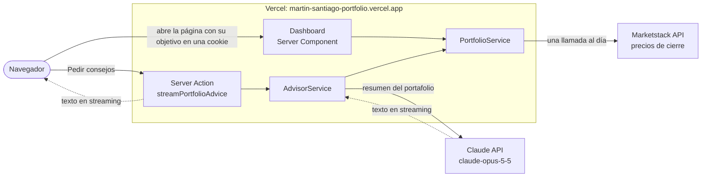

# Portafolio Martín Santiago

Desafío técnico para Fintual.

**URL producción (Vercel):** [martin-santiago-portfolio.vercel.app](https://martin-santiago-portfolio.vercel.app)

## Cómo lo pensé

### 1. Entender qué pedían

El enunciado pide una clase `Portfolio` con acciones, un reparto objetivo y un método que diga qué vender y qué comprar para llegar a ese reparto target. Lo reduje a una pregunta: **si hoy mi plata está repartida de una forma y yo quiero otra, ¿qué movimientos hago?**

### 2. Las piezas mínimas

- Una acción (`Stock`) solo necesita su nombre y su último precio, que entrega con `currentPrice()`.
- Un portafolio (`Portfolio`) tiene dos listas: lo que tengo (cuántas acciones de cada empresa) y lo que quiero (qué porcentaje de cada una).
- El resultado es una lista de órdenes: vender o comprar, cuántas acciones y por cuánta plata.

### 3. La cuenta, con un ejemplo

Tengo US$1.000: una acción de META a US$600 y una de AAPL a US$400. Quiero 40% META y 60% AAPL.

| Acción | Vale hoy | Debería valer | Diferencia | Orden |
|---|---|---|---|---|
| META | US$600 | 40% de 1.000 = US$400 | sobran US$200 | vender 200 ÷ 600 = 0,33 acciones |
| AAPL | US$400 | 60% de 1.000 = US$600 | faltan US$200 | comprar 200 ÷ 400 = 0,5 acciones |

Lo que vendo paga justo lo que compro. Siempre pasa, porque los porcentajes del objetivo suman 100%: el total no cambia, solo cambia cómo se reparte.

Eso es todo `rebalance()`: el valor total, cuánto debería valer cada acción, la diferencia con lo que vale hoy y esa diferencia dividida por el precio.

### 4. Los casos borde

- Si tengo una acción que no está en el objetivo, su objetivo es 0% y la vendo entera. En mi portafolio pasa con con la acción Unity.
- Si una acción está en el objetivo pero no la tengo, la compro desde cero. Pasa con con la acción de Roblox.
- Las diferencias de menos de un centavo las ignoro, para redondear.
- Si el objetivo no suma 100%, hay acciones repetidas o algún precio es cero o negativo, el portafolio no se arma y maneja el error.

### 5. Lo que se asume

- Se pueden comprar fracciones de acción, como en la mayoría de los brokers hoy. Con acciones enteras habría que redondear y manejar un vuelto.
- No entra plata nueva: el plan solo reordena lo que ya está ingresado como seed.
- Todo está en dólares. Nintendo y Sony van por sus ADR en Estados Unidos, así no hay que convertir monedas.
- `currentPrice()` devuelve el último precio con el que se creó la acción. Ir a buscar precios a internet queda fuera de la clase, así `Portfolio` no depende de ninguna API y es fácil de probar.
- Uso números decimales normales. El plan es una sugerencia; para ejecutar órdenes reales usaría un tipo decimal exacto.

### 6. Probarlo

Antes de la interfaz escribí los tests del dominio: portafolio ya balanceado, acción que sobra, acción que falta, vender todo, comprar desde cero, que lo vendido sea igual a lo comprado y cada error. Están en [`portfolio.test.ts`](src/modules/portfolio/entities/portfolio.test.ts) y corren con `yarn test`, me ayudé del design system de opencode, mi ade de preferencia.

### 7. Una segunda opinión con Claude

La cuenta es mecánica: no sabe nada de las empresas. Por eso agregué un botón que le pasa a Claude el portafolio y el plan; Claude opina sobre cada acción y dice si está de acuerdo con la orden. La respuesta aparece mientras la escribe mediante streaming de tokens. No es un consejo financiero.

### 8. Cómo ordené el código

Arquitectura hexagonal, separada por tema:

- `portfolio`: el dominio (`Stock`, `Portfolio` y `rebalance()`), sin nada de Next.js ni de APIs.
- `market-data`: los precios. Con clave usa Marketstack; sin clave, precios de ejemplo.
- `advisor`: los consejos de Claude.

La interfaz solo llama a los servicios y nunca habla directo con una API.

### 9. Qué haría con más tiempo

- Guardar posiciones y objetivos en una base de datos.
- Poder depositar o retirar plata al rebalancear.
- Un margen mínimo para no mover acciones por diferencias chicas.
- Un límite de consejos por visitante en el sitio público.
- Mejorar el flujo agéntico para los movimientos.

## Conexiones externas

- **Marketstack** entrega los precios de cierre diarios. Pido todas las acciones en una sola llamada y la guardo un día, para no gastar el plan gratis de 100 llamadas al mes.
- **Claude** recibe un resumen del portafolio: porcentajes actuales, objetivos y órdenes, sin montos en dólares. Responde en streaming y la respuesta se guarda 15 minutos.
- Las claves de las dos APIs viven solo en el servidor, como variables de entorno en Vercel.
